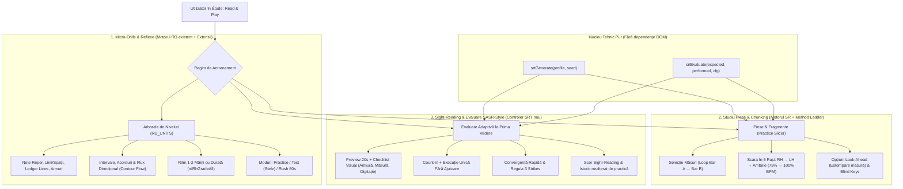

# Sight-Reading Adaptiv pentru Étude — Research, Review & Plan de Implementare

**Goal:** Transformarea funcțiilor existente de citire din `etude.html` într-un sistem complet de învățare și evaluare a citirii la prima vedere (*sight-reading*) la pian, combinând cele mai eficiente mecanisme din **Piano Marvel**, **Complete Music Reading Trainer / Rhythm Trainer** și **Sight Reading Factory**.

**Architecture:** Păstrăm arhitectura statică single-file (`etude.html`) și motoarele existente `RD` (Reading Drills V3) și `SR` (Sight-Reading & Pieces). Extindem aplicația prin funcții pure și deterministe pentru generarea partiturilor (`srtGenerate`), evaluarea multidimensională (`srtEvaluate`), antrenamentul de *Look-Ahead*, decuparea pe măsuri (*Practice Slicer / Method Ladder*) și evaluarea adaptivă cu convergență rapidă (`SRT` / stil SASR).

**Tech Stack:** HTML5/CSS3/JavaScript vanilla (ES2022), SVG custom renderer (`srRender` / `rdSvg`), Web Audio API, Web MIDI & Web Bluetooth MIDI, `localStorage` cu sincronizare multi-tab (`BroadcastChannel` / `storage`), Playwright pentru suita de teste E2E.

---

## 1. Domeniu și Nivelul Verificării

- **Data cercetării și revizuirii:** 6 noiembrie 2026.
- **Aplicații analizate:**
  - **Piano Marvel** („Marvel Piano”) — în special modulele **SASR** (*Standard Assessment of Sight Reading*), **Method & Technique** (sistemul de *chunking* / *Minis*) și **Sight-Reading Samurai**.
  - **Complete Music Trainer / Complete Music Reading Trainer & Complete Rhythm Trainer** (Binary Guilt Software) — structura de micro-exerciții progresive pe capitole, sistemul de stele, modul *Arcade/Rush* și antrenamentul ritmic la două mâini.
  - **Sight Reading Factory** — generarea algoritmică la cerere bazată pe constrângeri muzicale stricte (măsură, armură, ambitus, vocabular ritmic, salturi de intervale) pentru a preveni memorarea.
- **Principiu de inginerie și produs:** Adaptăm mecanicile pedagogice validate și arhitectura de feedback în timp real, păstrând identitatea vizuală și codul original din **Étude**.

---

## 2. Sinteza Research-ului Comparativ

### A. Piano Marvel
- **SASR (Standard Assessment of Sight Reading):**
  - Evaluează obiectiv citirea la prima vedere pe o scară de 18 niveluri principale (90 sub-niveluri, scor 100–1900).
  - **Fluxul unei probe:** Pre-vizualizare de **20 de secunde** fără a cânta (scanarea cheii, armurii, măsurii, conturului și poziției mâinilor) $\to$ **Count-in** (1 măsură de metronom) $\to$ **Execuție unică** în tempo fix $\to$ Prag de promovare de **80% acuratețe**.
  - **Regula celor 3 greșeli (3 Strikes):** Sub 80% acuratețe se primește un *strike* (`✗`). Testul se oprește la al 3-lea strike și calculează scorul în funcție de plafonul de dificultate atins.
- **Method & Technique (Chunking / „Minis”):**
  - Împarte piesele în fragmente mici (1–4 măsuri) exersate într-o scară progresivă:
    1. Mâna dreaptă (Wait/Prepare mode $\to$ Tempo)
    2. Mâna stângă (Wait/Prepare mode $\to$ Tempo)
    3. Ambele mâini (Tempo redus $\to$ Tempo 100%).
  - **Feedback cromatic instantaneu pe partitură:** verde (înălțime și timp corect), roșu (înălțime greșită, cu afișarea notei apăsate), galben/portocaliu (decalaj ritmic) și gri (notă omisă).

### B. Complete Music Reading Trainer & Complete Rhythm Trainer
- **Progresie gamificată pe micro-obiective:**
  - Introduce câte 2–4 note sau un singur concept ritmic/armonic nou pe nivel.
  - Separă două căi cognitive distincte:
    1. **Simbolică:** Portativ $\to$ Numele notei (`C, D, E` / `Do, Re, Mi`).
    2. **Motorie directă:** Portativ $\to$ Clapa pianului (fără verbalizare intermediară).
- **Izolarea ritmului:** Antrenarea citirii ritmice (inclusiv coordonarea la două mâini și respectarea duratelor/pauzelor) separat de stresul găsirii înălțimii notelor.

### C. Diagrama Arhitecturală a Modelului Hibrid pentru Étude



---

## 3. Auditul Codului Existent din `etude.html` și Review-ul Propunerii

### 3.1. Ce există deja în `etude.html` (și reutilizăm integral)

Verificarea directă a codului și rularea suitei Playwright (`npm run test -- --workers=4` $\to$ **69 passed**) confirmă că aplicația are deja o fundație solidă:

| Componentă existentă | Locație în `etude.html` | Stadiu actual |
| :--- | :--- | :--- |
| **Curriculum tip CMRT V3 (`RD_UNITS`, `RD_LV`)** | Liniile `6650–6748` | **Complet:** 10 capitole (`tr`, `ba`, `gr`, `ac`, `ks`, `iv`, `ch`, `rh`, `cc`, `sr`), 59 de exerciții, moduri `practice`, `test` (1–3 stele) și `rush` (60s). |
| **Selecție adaptivă & Heatmap pe portativ** | `rdWeight` (`6792`), `rdHeat` (`7156`) | **Complet:** Ponderează automat notele greșite sau lente și desenează heatmap pe fiecare cheie în tab-ul `Statistics`. |
| **Evaluator de ritm la 1 și 2 mâini cu durată** | `rdRhGradeHand` (`6988`), `rdRhGradeAll` (`7002`) | **Complet:** Măsoară eroarea de atac în ms (`good` $\le 100\text{ms}$, `near` $\le 180\text{ms}$), durata apăsării (`early`/`late` release) și tendința de *rushing/dragging* (`mean`). |
| **Motorul de partitură `SR` (`learn` & `assess`)** | Liniile `6429–6648` | **Funcțional, dar necesită extindere:** Suportă Wait Mode (`learn`), tempo cu count-in (`assess`), separare `rh`/`lh`/`both` cu redare automată a mâinii inactive (`srPlayGap`). |
| **Generatorul `rdSightGen`** | Liniile `7036–7054` | **Bazal:** Generează 4 măsuri în 4/4, doar major, cu bas din note întregi pe `grand` staff. |
| **Persistență & Sync Multi-Tab** | `saveAll`, `syncData`, `SYNC_ADD`, `SYNC_MAX` | **Complet:** Salvare în `localStorage` (`ptt-v3`) și sincronizare între ferestre deschise. |

---

### 3.2. Cele 6 Îmbunătățiri Critice Rezultate din Review

#### 1. Protecția scorului în `SR` împotriva „Keyboard-Mashing” și diferențierea erorilor
- **Problema actuală în cod (`etude.html:6590–6609`):** În `srAssessFinish`, procentul `pct` este calculat strict ca `Math.round(100 * good / totalN)`. Variabila `SR.wrongExtra` este doar afișată textual, fără să penalizeze scorul. Dacă un utilizator apasă toate clapele simultan sau adaugă zeci de note greșite, poate obține în continuare `100% ★★★`. În plus, în `srAssessLoop`, o notă apăsată greșit nu este desenată pe portativ.
- **Soluția tehnică:**
  - Introducerea funcției pure `srtEvaluate(expected, performed, config)` care calculează un scor bazat pe **precizie și rechemare (F1-score)** pentru înălțimi și penalizează atacurile suplimentare (`wrongExtra`) și intrările peste pauze.
  - Desenarea **notelor-fantomă roșii** pe portativul `SR` atunci când se cântă o înălțime greșită (similar cu ce face deja `rdFeedback` la linia `6886` pentru drills) și marcarea distinctă a notelor cu atac întârziat/anticipat (`near` = galben/chihlimbar) față de cele omise (`missed` = gri).
  - Afișarea deviației ritmice medii în milisecunde (*„La timp: +8 ms”* / *„Ai grăbit cu -42 ms”*), preluând matematica din `rdRhGradeHand`.

#### 2. Citirea Direcțională / Intervalică și Digitația de Ancorare (Fingering `1–5`)
- **Problema pedagogică:** Citirea fluentă la prima vedere nu se face silabisind fiecare notă (*Fa4 – Sol4 – La4*), ci prin identificarea **notei de start + degetul recomandat (1–5)** și urmărirea **conturului intervalic** (pas, salt de terță linie-la-linie, repetiție).
- **Soluția tehnică:**
  - Generatorul `srtGenerate` calculează și atașează **digitația de ancorare (`finger: 1..5`)** pe prima notă a fiecărei poziții de mână și la schimbările de poziție, randată în SVG deasupra/dedesubtul portativului.
  - Adăugarea unui micro-drill de **„Contour & Interval Flow”** în care utilizatorul cântă grupuri scurte de 3–5 note legate intervalic, antrenând recunoașterea tiparelor vizuale.

#### 3. Antrenamentul de „Look-Ahead” (Privirea în avans) și „Blind Keys”
- **Problema pedagogică:** În modul `learn`, `srTargets()` (`etude.html:6546`) luminează clapa-țintă pe claviatura din dock. Utilizatorul ajunge să privească tastatura virtuală în loc să citească partitura și nu își dezvoltă privirea cu 1–2 timpi în avans (*eye-hand span*).
- **Soluția tehnică:**
  - **Opțiunea „Look-Ahead (Hide Current Beat)”:** În timpul redării în tempo, nota sau jumătatea de măsură curentă se estompează (`opacity: 0.12`) imediat după momentul atacului ei, obligând ochii să citească timpii următori.
  - **Opțiunea „Blind Keys” (Fără indicii pe clape):** În modurile de Sight-Reading și Evaluare, iluminarea preventivă `target` pe claviatura de jos este oprită implicit (în modul `learn` apare doar ca *hint* opțional după o greșeală sau după 2.5 secunde de inactivitate).

#### 4. Extinderea Generatorului Procedural (`srtGenerate`) la 6 Trepte Structurate (P1–P6)
- **Problema actuală în cod (`etude.html:7036–7054`):** `rdSightGen` generează doar 4 măsuri în `4/4`, doar în major, fără pauze și cu mâna stângă blocată pe note întregi în `grand` staff.
- **Soluția tehnică:**
  - Generator determinist pe bază de `seed` (PRNG `mulberry32`), care produce măsuri validate muzical pe 6 trepte de pian (`P1`–`P6`) și 18 sub-niveluri:
    - **Măsuri:** `4/4`, `3/4`, `2/4` (și `6/8` în treptele avansate).
    - **Tonalități:** Majore și minore (cu sensibilă ridicată armonic în cadențe).
    - **Pauze scrise:** Pauze de pătrime și doime integrate în frază (cu verificare că utilizatorul nu apasă clape în timpul pauzei).
    - **Tipare pentru mâna stângă (LH) în Grand Staff:** Note întregi $\to$ doimi (tonic-dominantă) $\to$ pătrimi în contramișcare $\to$ bicorduri armonice (terțe/cvinte/șecste).

#### 5. „Practice Slicer & Method Ladder” (Chunking tip Piano Marvel pentru Piese)
- **Problema actuală:** Piesele din `PIECES` (`etude.html:6400–6428`) pot fi exersate doar integral, de la măsura 1 până la final.
- **Soluția tehnică:**
  - **Bar Range Selector (Loop Măsura A $\to$ Măsura B):** Permite izolarea oricărui grup de 1–4 măsuri dintr-o piesă.
  - **Scara de 6 Pași (Method Ladder):** Ghidaj automat pe fragmentul selectat:
    1. Mâna dreaptă — Pas cu pas (`learn`)
    2. Mâna dreaptă — În tempo (`assess`)
    3. Mâna stângă — Pas cu pas (`learn`)
    4. Mâna stângă — În tempo (`assess`)
    5. Ambele mâini — Tempo redus (75% BPM)
    6. Ambele mâini — Tempo țintă (100% BPM).

#### 6. Evaluare Adaptivă cu Convergență Rapidă și Separarea Strictă a Primei Vederi
- **Problema:** O piesă deja ascultată (`srListen`) sau repetată nu mai este *sight-reading*, ci exersare din memorie. De asemenea, un test care urcă liniar cu câte +1 sub-nivel obosește utilizatorul.
- **Soluția tehnică:**
  - **Fingerprint canonic & Tracking de expunere:** De îndată ce o partitură este afișată în preview sau ascultată, amprenta ei (`fingerprint`) este marcată ca *expusă*. Reîncercările sunt permise și încurajate ca **Practică**, dar numai **prima încercare neasistată** pe un fragment nou contează pentru scorul de *Sight-Reading*.
  - **Fast-Convergence Adaptive Algorithm (8 probe max / 3 Strikes):**
    - Pre-vizualizare de **20 secunde** cu checklist vizual (Cheie, Armură, Măsură, Tempo, Deget de start).
    - Dacă înălțimile $\ge 96\%$ și ritmul $\ge 90\%$ $\to$ **salt rapid (+2 sub-niveluri)**.
    - Dacă înălțimile $\ge 85\%$ și ritmul $\ge 80\%$ $\to$ **avans normal (+1 sub-nivel)**.
    - Sub prag $\to$ **1 Strike (`✗`)** și ajustare cu $-1$ sau $0$ sub-niveluri. La 3 strikes (sau 8 fragmente parcurse), testul se încheie și afișează nivelul calibrat.

---

## 4. Curriculumul Propus pentru Pian (Treptele P1–P6)

Păstrăm intacte toate unitățile și ID-urile existente din `RD_UNITS` (`tr1..sr5`) pentru compatibilitate 100% cu salvările utilizatorilor și adăugăm profilurile de citire la prima vedere pentru pian:

| Treaptă | Sub-niveluri | Obiectiv Pedagogic | Constrângeri Muzicale (`srtGenerate`) |
| :--- | :---: | :--- | :--- |
| **P1 — Ancore & Poziția de 5 Degete** | `1.1 – 1.3` | Citire fără privit la clape în poziție fixă (Do4–Sol4 / Do3–Sol3) | Cheia Sol și Cheia Fa separat; ambitus 5 note; pătrimi și doimi; `4/4`; digitație marcată pe prima notă. |
| **P2 — Contur Melodic & Pauze** | `2.1 – 2.3` | Citire direcțională (secunde și terțe) și respectarea pauzelor | Măsuri `4/4` și `3/4`; secunde, terțe și note repetate; pauze de pătrime/doime; ambitus de o octavă. |
| **P3 — Subdiviziuni & Ritm Punctat** | `3.1 – 3.3` | Integrarea optimilor și a pătrimii cu punct în flux continuu | Optimi perechi, pătrimi cu punct + optime; salturi până la cvintă; tempo moderat. |
| **P4 — Armuri Simple & Mod Minor** | `4.1 – 4.3` | Aplicarea armurii în timp real (Sol major, Fa major, La minor, Mi minor) | `keyN` $\in \{-1, 0, +1\}$, major și minor armonic; alternarea mâinilor în `grand` staff. |
| **P5 — Grand Staff: Melodie + Bas** | `5.1 – 5.3` | Coordonarea ambelor mâini la prima vedere | Ambele mâini simultan: melodie în dreapta + bas de note întregi/doimi/pătrimi pe treptele I–IV–V în stânga. |
| **P6 — Intervale Armonice & Texturi** | `6.1 – 6.3` | Citirea verticală (bicorduri, acorduri simple și deplasări de poziție) | Bicorduri (terțe, cvinte, șecste), triade și armuri până la 2 diezi/bemoli; măsuri `4/4`, `3/4`, `6/8`. |

---

## 5. Contracte Tehnice și Structuri de Date

### 5.1. Schema de Date (`data.reading.sight`)
Extindere aditivă în `rdData()` (`etude.html:6659`), păstrând cheia de stocare `ptt-v3`:
- `schemaVersion: 1`
- `rating`: nivelul curent calibrat de sight-reading și istoricul evaluărilor.
- `exposures`: dicționar compact de amprente (`fingerprint -> timestamp`) pentru a garanta că evaluările folosesc exclusiv partituri la prima vedere.
- `attempts`: dicționar indexat după `id` unic (limitat la ultimele 500 de intrări după comasarea multi-tab în `syncData`), conținând:
  - `{ id, ts, mode, profileId, seed, fingerprint, firstSight, bpm, hands, pitchAcc, rhythmAcc, f1Score, meanOffsetMs, extraNotes, missedNotes, status }`
- `prefs`: `{ lookAhead: false, blindKeys: false, previewSec: 20 }`.

### 5.2. Funcțiile Pure Noi
1. `srtGenerate(profile, seed)`:
   - Utilizează un generator pseudo-aleatoriu determinist (`seed`) pentru reproductibilitate în teste.
   - Construiește fraze de 4–8 măsuri cu final cadențial pe tonică, atașează `finger` (1–5) și returnează un obiect compatibil direct cu `srRender(piece)` + `fingerprint` canonic.
2. `srtEvaluate(expected, performed, config)`:
   - Independent de DOM; poate fi testat unitar direct prin `page.evaluate` în Playwright.
   - Împerechează monoton evenimentele MIDI/tastatură cu notele așteptate.
   - Returnează: `{ pitchAcc, rhythmAcc, f1, good, near, wrongPitch, missed, extra, restViolations, meanOffsetMs, noteResults, ghostNotes }`.
3. `srtSlicePiece(piece, startBar, endBar)`:
   - Extrage măsurile `[startBar, endBar]` din orice piesă existentă și recalculează offset-ul de timpi pentru exersarea pe segmente (*Practice Slicer*).

---

## 6. Planul de Implementare pe Etape (Task-by-Task)

Fiecare task urmează ciclul: **Test Playwright/unitar $\to$ Implementare în `etude.html` $\to$ Verificare E2E + Regresie**.

### Etapa 1 — Corectitudinea Evaluării și Feedback Vizual Avansat în `SR` (Prioritate P0)
- **Task 1.1: Evaluatorul pur `srtEvaluate` și eliminarea exploit-ului de scor**
  - *Fișiere:* `etude.html` (înaintea `srAssessFinish`), `tests/app.spec.mjs`.
  - *Detalii:* Penalizează `wrongExtra` și atacurile pe pauze prin scor F1; separă precizia înălțimilor de precizia ritmică; calculează `meanOffsetMs` (rushing/dragging).
- **Task 1.2: Note-fantomă roșii, „Near-timing” și diagnostic ritmic pe partitură**
  - *Fișiere:* `etude.html` (`srRender`, `srPaintAll`, `srAssessFinish`).
  - *Detalii:* Afișează pe portativ notele apăsate greșit în timpul evaluării și colorează distinct notele cântate cu decalaj mic (`near`).

### Etapa 2 — Generatorul Procedural V2 (`srtGenerate`), Digitație și Treptele P1–P6 (Prioritate P0)
- **Task 2.1: Generatorul determinist pe bază de seed cu măsuri `4/4`, `3/4`, pauze și minor**
  - *Fișiere:* `etude.html` (lângă `rdSightGen`), `tests/app.spec.mjs`.
  - *Detalii:* Implementează profilurile `P1`–`P6`, controlează ambitusul, salturile maxime, pauzele și tiparele de mâna stângă pe `grand` staff.
- **Task 2.2: Randarea digitației de ancorare (`1–5`) și amprenta `fingerprint`**
  - *Fișiere:* `etude.html` (`srRender`, `rdData`, `syncData`).
  - *Detalii:* Afișează numărul degetului de start peste prima notă și marchează partitura în `data.reading.sight.exposures` la afișare sau ascultare.

### Etapa 3 — Antrenamentul „Look-Ahead”, „Blind Keys” și „Practice Slicer” (Prioritate P1)
- **Task 3.1: Opțiunile Look-Ahead (estomparea măsurii curente) și Blind Keys în `SR`**
  - *Fișiere:* `etude.html` (controalele din `#rdp-pieces`, `srAssessLoop`, `srTargets`), `tests/app.spec.mjs`.
  - *Detalii:* Ascunde sau estompează notele imediat după trecerea timpului lor pentru a forța privirea în avans; dezactivează iluminarea preventivă a clapelor în modul Sight-Reading.
- **Task 3.2: Practice Slicer (Loop Măsura A–B) și Scara în 6 Pași (Method Ladder)**
  - *Fișiere:* `etude.html` (`srtSlicePiece`, UI pentru selecția măsurilor și progresul pe cei 6 pași: RH Learn $\to$ RH Tempo $\to$ LH Learn $\to$ LH Tempo $\to$ Both 75% $\to$ Both 100%).

### Etapa 4 — Modul de Evaluare Adaptivă a Citirii la Prima Vedere (SASR-Style) și Statistici (Prioritate P1)
- **Task 4.1: Controlerul de sesiune `SRT` (Preview 20s $\to$ Count-in $\to$ 3 Strikes)**
  - *Fișiere:* `etude.html`, `tests/app.spec.mjs`.
  - *Detalii:* Fereastra de pre-vizualizare de 20s (cu opțiune de „Pornește acum”), blocarea ajutoarelor în timpul evaluării, algoritmul adaptiv cu convergență rapidă (+2 / +1 / Strike) și oprirea la 3 strikes.
- **Task 4.2: Cardul „Sesiunea de azi” și Graficul de Progres în `Statistics`**
  - *Fișiere:* `etude.html` (`rdRenderHome`, `rdRenderStats`), `tests/app.spec.mjs`.
  - *Detalii:* Afișează evoluția nivelului de sight-reading, acuratețea pe înălțimi vs. ritm și recomandă automat următorul exercițiu în funcție de slăbiciunile detectate.

---

## 7. Verificare și Criterii de Acceptare

1. **Comandă pentru teste țintite:**
   ```sh
   npx playwright test tests/app.spec.mjs --grep "sight-reading" --workers=1
   ```
2. **Comandă pentru întreaga suită de regresie:**
   ```sh
   npm run test -- --workers=4
   ```
3. **Condiții obligatorii de acceptare:**
   - Apăsarea aleatorie a clapelor suplimentare nu mai poate produce scor de 100% sau 3 stele.
   - Toate semințele (`seed`) din testele pentru `P1`–`P6` produc măsuri complet validate ritmic și încadrate în ambitus.
   - Nicio piesă ascultată anterior cu `Listen` sau repetată nu poate crește ratingul oficial de *Prima Vedere*.
   - Comutarea limbii (Română / Engleză), tema Dark/Light, layout-ul mobil (320px), sincronizarea între taburi și funcționarea offline (`sw.js`) trec fără erori.

---

## 8. Surse de Referință

1. **Piano Marvel — Sight-Reading & SASR Overview:** https://pianomarvel.com/en/sight-reading
2. **Piano Marvel — Structura și Algoritmul SASR:** https://pianomarvel.com/en/feature/sasr
3. **Complete Music Trainer (Web/Desktop Suite):** https://completemusictrainer.com/
4. **Complete Music Reading Trainer (Binary Guilt Software):** https://completemusicreadingtrainer.com/
5. **Complete Rhythm Trainer:** https://completerhythmtrainer.com/
6. **Sight Reading Factory — Procedural Sight-Reading Generation:** https://www.sightreadingfactory.com/
